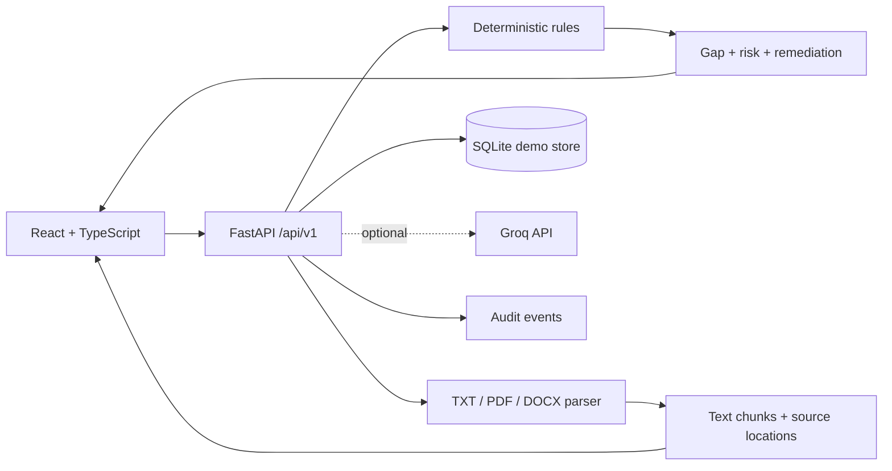

# RegulaAI

## From regulatory change to verified compliance

RegulaAI is an agentic compliance intelligence workspace for banking teams. It turns a regulatory document into a reviewable chain of evidence:

```text
Regulation -> Obligation -> Applicability -> Control -> Evidence
		   -> Test -> Gap -> Risk -> Remediation -> Audit trail
```

The product is designed around the question that matters in a compliance review:

> “Show me exactly why this requirement was considered covered, what evidence supports it, and who approved the resulting action.”

## Why RegulaAI is competitive

Most compliance prototypes stop at document summarization or a chatbot answer. RegulaAI focuses on the operational handoff between regulatory intelligence and accountable action.

### 1. Traceability over text generation

Every demonstrated finding is connected to an obligation, control, evidence state, risk score, remediation proposal, and audit event. Unsupported conclusions remain reviewable instead of being presented as compliance truth.

### 2. Deterministic risk, optional AI explanation

The numerical risk model is controlled by Python rules:

```text
Risk Score = Impact x Likelihood x Regulatory Criticality
```

The prototype thresholds are explicit and configurable. Groq may explain evidence, but it cannot secretly change a score, close a gap, or approve a remediation action.

### 3. Evidence is not compliance by existence

RegulaAI distinguishes current, partial, incomplete, and stale evidence. A report pack with a missing certification page creates a gap; it does not become a verified pass merely because a file exists.

### 4. Human governance is part of the workflow

Remediation requires an explicit approval. Gap transitions are validated by the backend, and meaningful actions create append-only application audit events.

### 5. Honest demo mode

The core experience runs without a paid API, database service, or cloud deployment. Demo records and deterministic fallbacks are clearly labelled. A failed live provider request is not silently converted into a fabricated success.

## The 3-minute judging demo

1. Open the Overview dashboard and show the linked risk, obligation, evidence, and gap metrics.
2. Open Regulatory Library and upload a TXT, PDF, or DOCX source document.
3. Inspect extracted text and stable provenance chunks.
4. Run the compliance assessment for quarterly regulatory reporting.
5. Show the missing certification evidence and the deterministic critical-risk result.
6. Open Risk Dashboard to explain the scoring factors.
7. Open Remediation Center and approve the proposed action.
8. Open Audit Trail to show the approval event.
9. Open Regulatory Changes to compare document versions and inspect related obligations, controls, evidence, and assessments.

## Implemented MVP surface

- Executive dashboard with backend-derived metrics
- Regulatory library upload for TXT, PDF, and DOCX
- Text extraction with stable chunk identifiers and PDF page provenance
- Obligation explorer with source references and review status
- Control framework and evidence center
- Compliance assessment workflow with explicit stages
- Gap register with validated lifecycle transitions
- Risk dashboard with severity distribution and score explanation
- Remediation center with human approval
- Regulatory change comparison with linked impact records
- Agent activity, audit trail, and configuration views
- SQLite persistence for documents and audit events
- Optional server-side Groq assistant endpoint
- SQLAlchemy traceability models and Alembic schema initialization
- Bounded lexical retrieval with citation-aware chunk results
- Typed assessment stage state with explicit review pauses
- Persisted assessment runs with stage-history list/detail APIs
- Backend demo-role authorization for remediation approval
- Demo reset and complete data-clear operations

## Architecture



See [docs/architecture.md](docs/architecture.md), [docs/api.md](docs/api.md), and [docs/demo_guide.md](docs/demo_guide.md).

## Quick start

### Backend

```powershell
cd "D:\ExA Hackathon\backend"
python -m venv .venv
.venv\Scripts\Activate.ps1
python -m pip install -r requirements.txt
python -m alembic upgrade head
python -m uvicorn main:app --host 127.0.0.1 --port 8000
```

### Frontend

In a second terminal:

```powershell
cd "D:\ExA Hackathon\frontend"
npm install
npx vite --host 127.0.0.1 --port 5173
```

Open http://127.0.0.1:5173.

API documentation is available at http://127.0.0.1:8000/docs.

## Groq configuration

Groq is optional. Create `backend/.env` with:

```env
GROQ_API_KEY=your_server_side_key
GROQ_MODEL=llama-3.1-8b-instant
GROQ_BASE_URL=https://api.groq.com/openai/v1
```

The key is loaded only by FastAPI. It is never placed in React environment variables or browser requests. Without it, RegulaAI remains usable in deterministic demo mode.

## Data management

SQLite is initialized automatically at `backend/regulaai.db`. The file is ignored by Git.

Restore synthetic demo records:

```powershell
Invoke-RestMethod http://127.0.0.1:8000/api/v1/demo/reset -Method Post
```

Clear application data while preserving source code and schema:

```powershell
Invoke-RestMethod http://127.0.0.1:8000/api/v1/demo/data -Method Delete
```

## Verification

```powershell
cd "D:\ExA Hackathon\backend"
python -m pytest -q

cd "D:\ExA Hackathon\frontend"
npm run build
```

The current verified baseline is 15 backend tests passing and a successful Vite production build.

## Feature honesty

| Capability | Status |
| --- | --- |
| Regulatory ingestion | Implemented for TXT/PDF/DOCX MVP flow |
| Obligation extraction | Seeded/source-linked demo records |
| Evidence-based assessment | Implemented with explicit incomplete/stale states |
| Deterministic risk prioritization | Implemented and tested |
| Human-approved remediation | Implemented and audited |
| Regulatory change impact | Implemented as a traceable illustrative comparison |
| SQLAlchemy/Alembic schema foundation | Implemented and tested |
| Lexical retrieval fallback | Implemented and tested |
| Typed assessment stage workflow | Implemented and tested |
| Persisted assessment stage history | Implemented and tested |
| PostgreSQL production adapter | Partial: schema is PostgreSQL-compatible, API runtime remains SQLite-first |
| LangGraph durable orchestration | Not yet complete: typed in-process fallback is used |
| Embedding retrieval/pgvector | Not yet complete |
| Demo-role authorization | Implemented for remediation approval; full authentication is not complete |

This is a hackathon prototype, not legal advice, certified regulatory software, or a guarantee of compliance. Synthetic bank records and illustrative regulatory excerpts are labelled as such.

## Security notes

- Never commit `backend/.env`, API keys, uploaded private documents, or `backend/regulaai.db`.
- Uploaded files are validated and parsed as data; they are never executed.
- Retrieved document content is treated as untrusted evidence, not as agent instructions.
- Consequential remediation actions require human approval.

## Project documentation

- [Architecture](docs/architecture.md)
- [API guide](docs/api.md)
- [Demo guide](docs/demo_guide.md)
- [Feature matrix](docs/feature-matrix.md)
- [Completion plan](docs/completion_plan.md)
- [Progress log](docs/progress.md)
