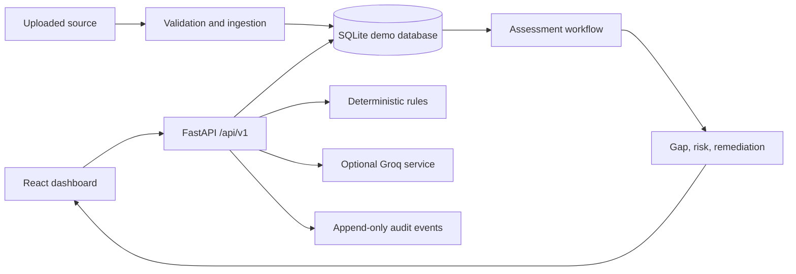
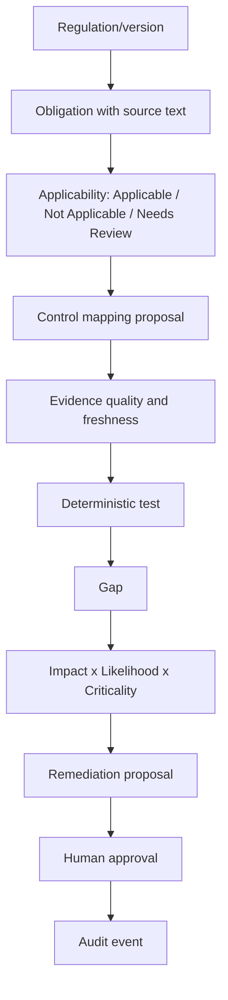

# RegulaAI Architecture

## MVP scope

The MVP demonstrates one complete, auditable path: a regulatory requirement is selected, applicability and control coverage are evaluated, evidence quality is checked, a deterministic risk is calculated, a remediation proposal is produced, and a human approval is recorded.

The application runs in local demo mode without external services. FastAPI owns all business logic and secrets. React calls only versioned API routes. The runtime database is SQLite by default; PostgreSQL/pgvector is the production-like upgrade path.

## Traceability workflow

## Honest limitations

The current implementation uses a local SQLite-compatible persistence layer with synthetic illustrative data. Groq remains optional and server-side only, while the system includes a durable checkpoint fallback and an optional vector search contract for PostgreSQL/pgvector environments. Full external authentication and production-scale vector indexing remain follow-on enhancements beyond the local demo scope.